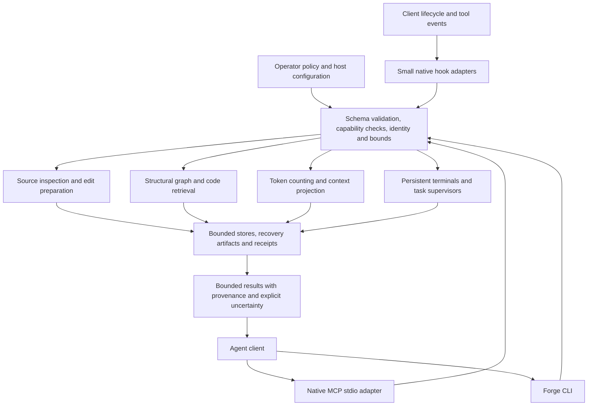

# Forge architecture

Forge is a local tool runtime between an agent client and a workspace. Its
architecture separates the model's requested action from operator-granted
capabilities, source identity, resource limits and persisted evidence.

In practice, a developer grants access to a project, the coding agent asks for a
specific fact or action, and Forge returns a bounded result tied to the files it
actually inspected. The agent decides how to use that result. Its model may run
locally or remotely; Forge's local execution does not determine that data flow.

## Components and control flow

The diagram groups boundaries; each command implements its own relevant checks.
A direct inspection command does not start the harness, and an ordinary CLI
operation does not automatically run inside its terminal sandbox.

| Package | Responsibility |
| --- | --- |
| `native/forge-cli` | Executable packaging/build identity and command routing, using `native/forge/src/main.rs` |
| `native/forge` | Reusable source, editing, context, retrieval, process, policy, storage and workflow implementations |
| `native/conductor-native` | Shared syntax/language registry, structural graph algorithms, configuration, search and evidence primitives |
| `native/slop-core` | Native source-quality and equivalence-related algorithms; optional guest runtimes remain separate |

The default executable is Rust with native dependencies and bundled SQLite. It
does not discover a Python interpreter or require Node/Electron. Explicit tools
that compile, profile or test user projects still need those projects' selected
toolchains. Optional embedding and clerical-model servers are external services,
not embedded inference engines or implicit GPU workloads.

## Entry points and lifetimes

**CLI.** Direct commands expose bounded source inspection, graph/retrieval,
context, tasks, governance and maintenance operations. A shell-capable agent can
use their structured output without an MCP service. Each invocation has its own
process startup cost and only explicitly persisted state survives.

**Persistent MCP tools.** The operator starts `forge harness` with exact roots,
write paths, program capabilities, resource budgets and a finite service lifetime.
A client-launched `harness stdio` adapter forwards requests to its verified Unix
socket. The backend owns terminals, compiled schemas and task state independently
of the client connection. Adapter disconnection does not itself terminate an
owned session. MCP transport alone does not create that lifetime guarantee.

**Hooks.** Client-specific native adapters run automatic lifecycle/policy/context
and telemetry work. They should return small summaries or references rather than
repeat full reports. Their protocol projection cannot weaken a native deny.
Automatic event handling and model-selected tools are complementary; the current
installers configure command hooks, not a universal MCP-hook replacement.

The client decides whether to discover/use tools and how to compose returned
content into a prompt. Installing a binary or hook does not prove that a live
client uses the intended native path. Client configuration/trust and hook support
must be verified on that client's actual local or cloud execution surface.

## Source, retrieval and edit data flow

Source reads enter through bounded directory-capability APIs. Native syntax
inspection returns definitions, spans, references and a hash of the inspected
bytes. Those are lexical/syntactic facts; unresolved calls, macro effects and
runtime dispatch remain explicit uncertainty.

There are two distinct retrieval stores:

- The structural graph at `.forge/graph.db` records native syntax facts, relative
  paths, relationships, hashes and conservative dependency coverage. Refresh
  reuses matching syntax facts and rebuilds changed snapshots. External
  `.code-review-graph/graph.db` is a read-only compatibility source with a
  different schema and semantics.
- Operator-selected code indexes publish immutable generations containing lexical
  and vector search data. BM25 works alongside exact cosine or HNSW candidates
  and exact reranking. Vectors bind their embedding space and source identity.
  Native refresh reuses vectors only when its origin and chunk/source/space
  identity match; new or changed chunks require new embedding work.

Queries check source/generation evidence and expose omitted or stale results.
Returned-endpoint validation does not prove discovery of every new caller or
current workspace membership. Newly added files require refresh. Structural,
textual and vector matches are not interchangeable evidence.

Edits start from an expected current hash and an exact path. Preparation checks
match counts, diff context and supported syntax without changing source. Applying
uses the relevant write capability and native publication/recovery protocol.
Recovery restores only an admitted current state; it is not permission to reset a
shared checkout. Context-only folds and projected diffs must not be executed as
source or applicable patches.

## Context and telemetry data flow

Offline BPE counting pins the tokenizer artifact and the operator's model
association. It counts the supplied rendered text, not an unknown provider chat
template or multimodal envelope. Byte-based conservative output budgets are
labelled separately from actual tokenizer counts.

Context compaction groups related tool messages, preserves protected instructions
and actionable errors, and writes recoverable originals before reductions or
old-group eviction. It reports overflow rather than claiming an over-budget
result fits. Recovery stores are bounded and do not silently prune originals.

Telemetry can describe observed provider usage and tool/context overhead when
those observations are available. Projection token counts, model-reported usage,
billed tokens, task success and elapsed task time are separate measurements.
Persisting fewer tokens is not proof that an agent solved its task better.

## Execution, ownership and durable state

The harness supervises persistent PTYs through readiness-driven native I/O,
bounded queues/replay and explicit session identifiers. Spawn retries reuse an
identity rather than launching a second uncertain process; input writes use
sequences to avoid duplicate delivery. The task journal records attempts, leases,
resource observations and receipt references.

Strict execution profiles verify supported Linux Landlock/seccomp/cgroup and
systemd controls before running a payload. Unsupported or weaker enforcement is
an error; there is no unconfined fallback for that profile. This does not imply
that every task command enables every optional resource limit.

Candidate workflows resolve an exact Git candidate and scoped policy, capture
inputs, execute explicitly granted checks and assess the resulting evidence.
Missing results, drift, cancellation and cleanup failures remain visible. A
local checksum or passing report establishes scoped consistency, not historical
execution authenticity, model authority, merge permission or deployment.

Persistent state has different lifetimes: project manifests and provider bindings;
service/session/task records; graph and search generations; context and edit
recovery; and check/performance receipts. Each surface specifies its own quotas,
leases, cleanup and retention. There is no universal “delete old state” policy.

## Invariants and trust boundaries

1. Model arguments cannot expand operator permissions or approve their own work.
2. Parsing/grammar guidance does not replace validation at dispatch.
3. Hashes bind bytes; they do not authenticate the producer or certify semantics.
4. Unsafe, stale, ambiguous, missing or unsupported states fail explicitly within
   the operation's contract; silent fallback cannot enlarge authority.
5. Output, parsing, source inventory, process resources and recovery storage have
   declared bounds. Their scopes are not identical to whole-task deadlines.
6. Publication stages complete data and checks expected current state. Most
   filesystem protections require cooperating writers and trusted configured
   ancestors; they are not hostile same-UID isolation or filesystem-wide atomicity.
7. Optional local-model output is clerical, not an approval or promotion receipt.

## Current boundaries and design debt

Native runtime availability, host adoption and full repository retirement are
separate states. Some Python maintenance/analysis entry points remain reachable.
Existing external schema-9 MCP configurations and host Make callers cannot be
silently redirected to a native schema-3 graph. Native graph seeding and stronger
shared index-publication/freshness factoring remain unshipped prerequisite work.
The separate reuse-analysis draft is not a released product capability.

MCP connection setup currently writes the supported project `.mcp.json` format;
other clients need their own settings. Provider adapters have different coverage.
Kernel prerequisites, an operator policy, tokenizer/model artifacts and optional
embedding endpoints remain real setup work. Native packaging does not complete
that setup or imply runtime adoption.

Measurements and migration receipts belong in focused documents rather than this
component map: [value/evidence audit](docs/benefits.md),
[performance methodology](docs/performance.md), [retrieval results](docs/native-code-retrieval-measurement.md),
[migration/evidence status snapshot](docs/native-migration-evidence-status.md),
[migration history](docs/native-migration-history.md), and its
[archive](docs/native-migration-history-archive.md). Detailed interfaces are in
[code tools](docs/native-code-tools.md), [graph context](docs/graph-context.md),
[search](docs/native-code-search.md), [context](docs/native-context.md),
[harness](docs/native-harness.md), [execution](docs/native-execution.md),
[providers](docs/native-providers.md) and [local verification](docs/local-checks.md).
