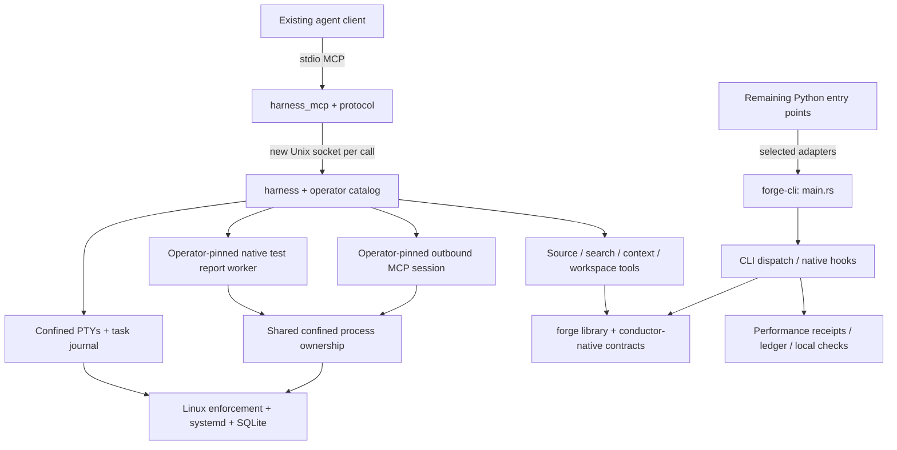

# llm-forge roadmap: native execution and agent productivity

## Current mission checkpoint — 2026-11-05

Forge supplies bounded native tools to existing coding agents. The mission is to
improve verified task outcomes, context use and execution cost while preserving
correctness and explicit operator authority. Native implementation, installation,
runtime activation and demonstrated agent benefit are separate milestones.

This checkpoint started from source baseline `9117c2fb6436251d0de50038db85ef7fbb81e4b3`.
The reviewed mutation repair landed in [PR #185](https://github.com/mcpirate17/llm-forge/pull/185)
as `f8c1ae9406e6e1f6d55c3bb15a26b3ef57c918b6`; its tree exactly matches the checked
PR head `966ae9a128458a6cbc488bfcd51bc574c4b623eb`. The canonical measurement and effectiveness report is
[performance.md](performance.md); historical delivery notes follow this checkpoint.
Open defects live in the [issue tracker](https://github.com/mcpirate17/llm-forge/issues),
not a parallel local defect ledger.

### Native reporting increment — merged, 2026-11-06

Issue [#208](https://github.com/mcpirate17/llm-forge/issues/208) moves explicit,
changed, coverage and canary reports to shared Rust validation and routes their
Make targets through the native CLI. The measured source is `d1fc4dd`; focused
validation passed 37 tests plus strict Clippy. Independent review cleared the
eligibility fast path and preserved input checks. The original slower baseline,
rejected path-lookup experiment, and final matched comparisons are recorded in the
[performance report](performance.md#native-report-migration-baseline--2026-11-06).
The final run completed all 90 observations with exact JSON/exit parity; explicit
reports matched Python's median, while coverage and canary remained slower.

A real two-mutant automatic control verified installed native receipt acceptance,
missing-identity debt and invalid-pin refusal. Make routes were traced with `UV=false`.
The final full 18-check gate passed with 4,850 test executions, zero failures and
189 ignored cases across 180 harnesses. Exact-head/current-base verification passed
before [PR #209](https://github.com/mcpirate17/llm-forge/pull/209) merged as `0c35e00`;
the merged tree matches checked head `58f32f3`. Existing Python host APIs remain compatibility surfaces; this
increment establishes neither host adoption nor complete Rust migration.
Remaining priorities include issue #196's ordinary mutation profiles and native
prompt/tool assistance. Report overhead remains a documented limitation, not a
general speedup claim; select the next increment from current user-value evidence.

Issue [#210](https://github.com/mcpirate17/llm-forge/issues/210) is delivered:
the shared dead-test classifier now backs `forge analyze tests` and `make dead-tests`
through native Git/reference collection, retaining advisory classifications and
explicit legacy JSON output. Focused classifier/input/path/report/CLI checks,
strict Clippy and the optional Python binding compile passed. Six retained report
pairs cover authored merge/rename/shallow fixtures and the actual Forge checkout;
the latter matched complete JSON and exits (123 modules, 17 tests, 35 advisory
unreferenced sources). Independent review checked all 98 commands and the exact
two intentional fixture differences. Clean source `1195b04` also passed 22 report
tests, two CLI tests and the stricter six-pair parity rerun. The matched three-arm
benchmark completed 108 executions: median native latency fell from 510.75 to
218.97 ms, while Python remained faster at 181.06 ms. Independent audit verified
all 18 receipts and exact report comparisons. The original slower baseline and
remaining gap are retained in the [performance report](performance.md#full-native-test-import-report--2026-11-06).
The full 18-check gate passed on `378ee44`: 4,889 passing test executions, zero
failures and 189 ignored across 181 harnesses. Exact-head/current-base verification
passed before [PR #211](https://github.com/mcpirate17/llm-forge/pull/211) merged as
`22ec5bf`; its tree matches the checked head. See the
[command contract](native-analysis.md#python-test-import-report). The subsequent
MCP integration is tracked in #212 below; no host adoption is claimed.

Issue [#212](https://github.com/mcpirate17/llm-forge/issues/212) is delivered:
an operator-enabled MCP report using the existing confined native worker owner.
It adds fixed-root admission, isolated Git configuration, report-specific
disconnect cancellation and bounded output. A first live attempt refused before
launch because a pinned executable also hit a smaller data-file limit. The
reviewed correction retains strict executable pins and ordinary data bounds.
Focused tests and strict Clippy passed; six new live controls and the existing
terminal-cancellation regression passed against release `2d23d1c`. Independent
audit verified real report parity on an authored repository, synthetic lifecycle
controls and owned cleanup. Subsequent shutdown controls passed for an observed
preparing request and an active detached worker tree, with cleanup checked before
explicit manager stop. The extended error control preserved exit 7 and UTF-8
stderr. Nine targeted live test executions passed; the original pre-launch
failure remains recorded. All 18 publication checks passed on `bbffed4`: 4,907
passing test executions, zero failures and 197 ignored across 182 harnesses
(including repeated feature-matrix cases). Fresh-base local verification passed
before [PR #213](https://github.com/mcpirate17/llm-forge/pull/213) merged as
`9299baa`; its tree matches the verified head.

The reproducible observation at `a3ac295` completed all 396 calls with exact
report parity. Scored inner medians were 2.22–2.36 ms for direct CLI and
79.99–80.59 ms for the configured confined MCP path. Its worker CPU limit differs
from direct CLI, and every request launches a new worker; this is documented
service cost, not a speedup or agent benefit. See the [performance report](performance.md#confined-mcp-test-report--2026-11-06)
and [evidence index](../research/performance/forge-program-20261106-mcp-test-report.json).
Filesystem preparation remains cooperative; the child deadline is not a hard
whole-operation deadline. No external-client or host adoption is claimed.

The active increment returns to [#196](https://github.com/mcpirate17/llm-forge/issues/196):
the explicit [confined Fest profile](mutation-fest.md) uses a pinned private guest
and the existing native command owner. It adds captured-snapshot bindings,
read-only empty bytecode caches, guest-first imports, complete kill attribution
and native guest inventory export. Clean release `234b60f` passed all three real
controls: strong `PASS` (three attributed kills), weak `RATCHET_HELD` (one survivor),
and collection-error `ERROR` (zero attributed kills). Independent audit matched
all outcomes and confirmed 20 child cgroups, three snapshots and three caches
absent before supervisor retirement. Native export matched all 1,302 guest entries.
Live and committed consumers accepted the strong receipt, rejected an admitted
supporting-input addition, and accepted exact restoration. An initial excluded
untracked `.txt` probe and all earlier debug/observer failures remain recorded.
Full publication checks are next. Unmarked Fest and Mull execution remain refused;
this does not establish general Python compatibility or agent productivity gains.
See the [evidence index](../research/performance/forge-program-20261106-confined-fest.json).

### Architecture, evidence and disposition

Paths below are relative to `native/forge/src/` unless qualified.

| Area | Actual implementation | Gap and available evidence | Disposition |
| --- | --- | --- | --- |
| Agent intelligence | `route.rs`, `ledger/`, `local_clerk/generate.rs`, `workspace_runtime_eval.rs`; existing client/model remains the agent | Routing, accounting and clerical generation exist. Runtime matrix completeness is not task-quality evaluation; no matched agent-success study | Retain accounting and deterministic tools; improve real-task controls. Local models are clerical only and cannot approve, authorize, promote or launch work |
| Context and tokens | `context_tools.rs`, `prompt_contract.rs`, `context_window.rs`, `context_store.rs`, `tokenizer.rs`, `context_telemetry.rs`; `conductor-native/src/context_projection.rs` | Composition, deferred catalog lookup, exact supplied-text counts and recoverable compaction exist. New literal prompt inspection/checklists share CLI/MCP implementation; automatic strengthening and tool recommendations remain incomplete. Historical reductions omit provider envelopes, rereads and task-quality effects | Retain these primitives; measure actual provider usage and recovery cost before expanding compression |
| CLI | `main.rs`, `dispatch.rs`, `candidate_cli.rs`, `project.rs` | Native command dispatch and hook adapters exist; matched startup/signature comparisons remain within the 10% regression budget. Host adoption requires independent verification | Improve readiness and exact workload profiling; retire duplicate interpreted callers only after parity and caller migration |
| MCP server | `harness_mcp.rs`, `harness_mcp_protocol.rs`, `harness_catalog.rs`, `harness_transport.rs`, `mcp_setup.rs` | Tools discovery/calls, schema validation, bounded concurrency and operator-selected capabilities exist. Custom wire integration tests and matched stdio adapter/CLI measurements exist; actual-client selection and agent outcomes remain unmeasured | Retain the native service/adapter split; improve client setup, lifecycle and actual-client validation |
| MCP client and prompts | `harness_outbound.rs`, `outbound_mcp_protocol.rs`, and the shared confined duplex owner provide one operator-pinned stdio endpoint; `context_tools.rs` searches supplied catalog snapshots | Real external Rust-server tests cover persistent calls, denied reads, schema/protocol failures and input drift. HTTP endpoints, credential forwarding, multi-endpoint routing and protocol prompts/resources remain outside this slice | Retain shared admission/ownership; measure first/warm cost and verify a real coding client before extending transport or routing |
| Performance | `performance.rs`, `performance_identity.rs`, `conductor-native/src/performance_receipt.rs`, `native/forge/benches/` | Sealed matched-receipt comparisons and component benchmarks exist. Current CLI baselines and historical retrieval/projection evidence do not establish productivity | Retain receipt integrity; improve transport/task measurements and include preparation/resource costs |
| Quality and tests | `native/forge/tests/`, `native/conductor-native/tests/`, `local_check.rs`, `sweep.rs`, `mutation_run.rs` | Full local checks and verification passed the merged repair tree; live-service tests remain opt-in. No new clean-host sweep or real-client validation is implied | Retain ordinary tests and automatic scoped mutation engines; verify each exact committed tree before landing |
| Rust migration | `native/forge-cli/Cargo.toml` owns the executable using `../forge/src/main.rs`; `native/forge` owns reusable code; `native/conductor-native` supplies shared contracts | `rg --files src -g '*.py'` currently finds 83 files. File count is not migration completion; caller/dependency retirement and clean-install/runtime evidence remain necessary | Prioritize measured live interpreted boundaries; retire replaced bodies and stale compatibility plumbing after complete caller migration |

### Actual dispatch and dependency flow

The service compiles its catalog/schema/grammar once; it cannot grant new paths,
executables, networking or budgets from model requests. Report cancellation closes
its one-shot connection and requests owned cleanup. Other RPC cancellation
suppresses the adapter response without undoing daemon work. Same-UID unconfined
programs remain trusted. See [the harness contract](native-harness.md).

Initial 2026-11-04 native graph snapshot at `.git/forge-program-graph.db`: 1,300 files, 18,327
definitions, 19,434 resolved references, 84,910 unresolved references and 54,387
dynamic references. These are syntactic inventory counts, without embeddings,
not a full semantic graph or proof that all dependency edges resolve. The external
code-review graph MCP was unavailable in this session; do not imply it validated
this audit.

### Ordered continuation and acceptance criteria

The descendant-cleanup and exact-test-target repairs landed in PR #198. The
Cargo freshness repair in PR #199 addresses [#197](https://github.com/mcpirate17/llm-forge/issues/197):
ordinary Cargo discovery-input freshness now passes the real automatic-engine
drift experiment and full source-bound gate below. Restoring the
broader profiles in [#196](https://github.com/mcpirate17/llm-forge/issues/196)
requires independently bound dependency manifests as well as confined execution.
**Implemented #196 Cargo workspace slice:** the explicit native-generated
`cargo-workspace-v2` profile reuses the confined command owner, complete snapshot
freshness, package metadata admission and a lock-verified offline seed. Native
archive staging avoids timestamp restoration without expanding syscall access.
Candidate and live/committed corpus validators independently select the expected
binding from the verified campaign. Package baseline observations require passing
tests; they are neither per-test attribution nor authenticated output.

The clean release at `fee612b` passed both authored workspace trials: 31 checks
for an excluded local path dependency and 34 with a registry dependency. Each
killed two automatic mutants, matched nonzero direct/engine baselines and removed
its three owned cgroups and snapshot. Supporting-source and test-data changes
caused receipt refusal in both live and committed views; exact restoration
restored scoped acceptance. A separate real-mutant timeout confirmed cleanup
and retention of the unrestored snapshot, with an incomplete ERROR receipt.
The [17-trial evidence index](../research/performance/forge-program-20261106-workspace-mutation.json)
retains failed attempts, earlier code versions, repeated fixtures and unstarted
checks; its statuses do not approve an entire candidate or demonstrate task benefit.

Actual Forge trials exposed three repaired integration defects: unrelated writer
outputs blocked exact source scope; Cargo's confined `../` shared-source paths
were rejected; and omitted dependency examples were treated as required inputs.
Selected dirty sources still require ownership. Symlinks and escaping paths
remain refused; only unselected dependency example/test/bench targets may be absent.
The fourth package-wide trial admitted all 338 registry packages and started the package
baseline, which failed because the C compiler could not read an ungranted system
header. It produced BASELINE_FAILED, with both owned scopes and snapshot removed.
Forge's complete package suite and engine remain unproven under these grants.

[PR #203](https://github.com/mcpirate17/llm-forge/pull/203) landed this workspace
slice as `623c3d8`. Its merged tree matched checked head `4891291`: all 18 local
checks and exact-head/current-base verification passed, with 4,755 passing
executions, zero failures and 188 ignored across 179 harnesses. The earlier
`0522270` gate and intermediate focused results remain historical observations.

The #196 slice at `4cba4eb` adds explicit library/integration-target selection,
a bounded libtest substring filter, matched direct/engine test inventories and
campaign-bound native admission. Selected test pins are partial anchors, not
complete test-file coverage. Both workspace profiles now refuse slashless
mutation subjects before testing or mutation: cargo-mutants interprets these as
recursive basename globs and could mutate unselected files.

Focused verification passed 575 test executions with zero failures and 28 ignored,
plus strict Clippy for both native packages. The initial malformed-selector test
failed because serde ignored an extra field on a unit enum variant; the struct
variant correction and direct-deserialization regression passed on rerun. Four
clean-release automatic controls each completed 31 checks: strong or whole-target
selection killed both mutants, while weak integration/library selection preserved
both survivors as RATCHET_HELD. Independent raw audits verified scope, corpus
drift/restoration and cleanup. [Results and limitations](performance.md#selected-workspace-test-controls--2026-11-06)
remain distinct from the full publication checks. [PR #204](https://github.com/mcpirate17/llm-forge/pull/204)
landed as `83990e2`, with a tree identical to checked head `c1c3a7e`. All 18 local
checks and exact-head/current-base verification passed: 4,804 passing executions,
zero failures and 188 ignored across 179 harnesses.

An explicit `/usr/include` read grant subsequently passed a small C-header
control. The actual Forge library filter `mutation_cargo_supporting::tests::`
then passed all five selected tests after a fresh 157-second build. Its automatic
engine timed out at 300 seconds; retained files list 55 mutants and 44 completed
outcomes (34 caught, seven missed, three unviable). The remaining states are
unknown. The snapshot is retained and all three owned process scopes are absent.
This is selected-baseline evidence, not a completed campaign or full package suite.
See the [measurement scope and evidence](performance.md#compiler-header-control-and-actual-forge-timeout--2026-11-06).

Implemented [#205](https://github.com/mcpirate17/llm-forge/issues/205): bounded,
explicitly incomplete engine progress after timeout, separate from scoring and
refused on passing receipts. The clean `ad6f12f` control completed all 12 diagnostic
checks and matched retained report hashes and canonical identity digests. It
observed two discovered mutants and zero completed outcomes before timeout; no
unstarted count is inferred. Two failed predecessor controls exposed and prompted
fixes for timeout reason propagation and JSON key-order dependence. Their failures
remain in the [evidence](performance.md#interrupted-cargo-progress-controls--2026-11-06).
[PR #206](https://github.com/mcpirate17/llm-forge/pull/206) landed as `c95592a`,
with a tree identical to checked head `6369de3`. All 18 local checks and
exact-head/current-base verification passed: 4,819 passing executions, zero
failures and 188 ignored across 179 harnesses. This is source and isolated-install
verification; no shared-host installation or actual-client activation is implied.

Implemented test work for #196 adds independent negative receipt-admission cases
for four observed predicate survivors and a reproducible opt-in Rust real-engine
timeout control. Focused tests and strict Clippy passed. The real test at `5f78e9b`
passed after two retained pre-payload configuration refusals; its native receipt
remains incomplete ERROR with two discovered and zero completed outcomes. The
fixture uses explicitly pinned tools and grants, automatic generation and the
existing process owner. [Measurements and limitations](performance.md#reproducible-native-timeout-fixture--2026-11-06)
remain separate from full publication validation and actual-package campaign PASS.
Next obtain useful bounded actual-package campaign evidence. Three other survivors
do not yet establish that their guards are redundant; retain them pending proof. Restore
Fest/Mull through the same command owner. A shared native coordinator for mutation
evidence, coverage and canary remains queued; migration must preserve legacy
identity and anchor semantics without weakening candidate approval requirements.
Read grants, test executables and environment are separate operator decisions;
a seed grants none. Broader platform priorities below remain open.

1. Validate and measure the implemented outbound MCP slice through the existing
   inbound service. It reuses the confined process owner, registers the endpoint
   separately from terminal programs, and admits one operator-pinned stdio tool
   with fixed arguments, schemas, read grants and resource limits. Networking
   and ambient credential forwarding remain disabled. Broader routing and HTTP
   support require separately verified authority and lifecycle contracts.
   Recommendation work is deferred pending prospective task-value controls;
   the first optional next-inspection candidate was measured and rejected below.
   External-host native receipt acceptance has a separate tracked boundary
   in [#186](https://github.com/mcpirate17/llm-forge/issues/186); ordinary execution
   works without vendored Forge sources. The explicit installed-identity path is
   now implemented and measured below; receipt-supplied identity cannot authorize
   itself. The bounded automatic Cargo attribution slice from
   [#190](https://github.com/mcpirate17/llm-forge/issues/190) landed in
   [PR #194](https://github.com/mcpirate17/llm-forge/pull/194); broader target and
   dependency support remains outside its verified scope.
2. Validate one real client: setup, advertised tools, an agent-selected read,
   allowed/denied/failure cases, reconnect and undo. Test the client-specific
   configuration rather than treating a custom wire client as client adoption.
   The first Codex CLI 0.166.0 probe reached discovery and attempted the three
   prescribed calls, but the client approval gate refused all of them. Cleanup
   was verified; the zero client exit code was rejected by the result oracle.
   [The failed attempt and observed usage](performance.md#actual-codex-approval-diagnostic--2026-11-05)
   remain evidence, not adoption success. A new probe awaits an explicit,
   narrowly scoped operator approval decision.
3. Evaluate deterministic prompt strengthening with explicit task modes, reusing
   composition, catalog filtering, token counts and recovery. Literal retention
   alone cannot establish preserved meaning, instruction priority or improved
   task success; report these limits and any added overhead.
4. Measure matched CLI versus actual MCP adapter calls with equivalent outputs;
   separate service/adapter startup and discovery from warm dispatch. Include
   schema/policy checks, socket connection and serialization in declared scope.
5. Extend the bounded inbound/outbound MCP workflow only after the local slice's
   real-client and performance evidence; preserve explicit endpoint, executable,
   credential and cancellation policy. Adapter cancellation currently suppresses
   the response; it does not prove that a daemon operation was undone.
6. Run bounded matched agent tasks with the same model, budget, source and tasks;
   independently verify outputs, report repetitions and failed/censored/unstarted
   cases, provider usage, recovery/rereads and embedding preparation.
7. Improve performance/effectiveness reporting and test intelligence using
   provenance-bound measurements, conservative affected-test selection and
   independent task oracles. Report uncertainty and selection coverage.
8. Use those measurements to simplify native migration, hook overhead and context
   paths. Retire proven duplicates and interpreted boundaries after caller/parity
   verification; add readiness/setup/status/undo without parallel machinery.

**Current source-tool interoperability increment:** `code_inspect` and `code_fold`
now advertise their verified read-only effects using four boolean MCP annotations.
The strict native catalog parser validates this optional metadata without using
it for dispatch or authority. Other tools, including arbitrary outbound tools,
remain unclassified. Catalog/schema tests and legacy/modern MCP discovery tests
passed (14 focused tests, one existing delegated-cgroup test ignored), as did
strict all-target Clippy and formatting. An initial test fixture omitted the
legacy initialization notification; the fixture was corrected without changing
production protocol handling. Independent review found no concrete blocker.
These annotations do not establish successful client approval or adoption; each
committed tree still requires its full publication checks.

**Verified native MCP increment:** the local outbound endpoint passed six opted-in
wire integration tests, seven protocol/controller tests (including delegated
prelaunch cleanup), and three admission tests. The shared owner passed all 22
opted-in process tests. Strict all-target Clippy passed after correcting an
unnecessary borrow in the resource-validation extraction. Two early wire runs
failed test-fixture permission and cgroup-layout assumptions; both were corrected
without changing admission or weakening cleanup assertions. Independent review
found no additional concrete blocker. Full local-check and local-verify passed all
18 steps at `5669fb33d3db9dac9b59fbec4680e8ac4df9efc8`: 4,653 successful test
executions, zero failures and 188 ignored across 179 harnesses. Receipt SHA-256:
`818e49f2ea3a3e39d7a585fc6c6a70549b6c7d6ca8be523e36ade6329aa6314e`.
The final release repeated all 22 owner, seven controller/protocol and six wire
tests with zero ignored cases. Five observations completed 160 selected-tool calls
with verified cleanup: warm medians were 1.259–1.333 ms; the ordinary CLI control
stayed within its existing budget. [The performance report](performance.md#native-outbound-mcp-observations--2026-11-05)
records identities, controls, failures and limitations. The final documentation
and test-guard head `bab611fd1274dd35a0b5cf21bbd77863fbb99581` also passed all
18 checks and local verification with the same counts; receipt SHA-256
`73b39250e1a71e1274ce145457d70af62c74d41463311257ed35e68429be05fe`.
[PR #201](https://github.com/mcpirate17/llm-forge/pull/201) merged as `d891e83`
with the exact checked tree. Successful real coding-client use, task benefit
and global installation remain separate unverified milestones.
See [the operator contract](native-harness.md#optional-outbound-mcp-tool).

**Rejected candidate:** optional next-inspection advice passed focused
behavior tests and actual MCP inspections but added 22–27 µs and 943 frame bytes
versus plain prompt preparation plus a known inspection call. Its schema added
1,276 bytes to every context-enabled catalog. Independent review recommended
deferral: the caller already supplied nearly the complete inspection recipe, and
beating a redundant discovery call did not establish value over the stronger
controls. The candidate was
removed from production; its implementation/tests remain in the experiment's PR
history. [Measurements and the rejection decision](performance.md#deferred-next-inspection-advice--2026-11-05)
retain failures, controls and evidence limits. No task-success, token-saving or
cost claim follows. Existing prompt operations and production schemas are unchanged.

**Completed repair cycle:** PR #185 closed
[#184](https://github.com/mcpirate17/llm-forge/issues/184). The exact issue command
now returns `READY`; `--include-covered` selects one Forge campaign, and Cargo
discovery finds 38 planner mutants (discovery, not executed coverage). The repair covers package ownership, configured receipt paths,
contained atomic publication, serialized process diagnostics, bounded child output
and shared native-source freshness. Independent review exposed and resolved
module-path edge cases, snapshot inventory drift, canonical path ordering and
aggregate mutation counts concealing an unmeasured selected file. All three
engines now require a reconciled per-source report; source coverage is not line or
operator coverage. Native diagnostic PGIDs remain separate from legacy reaper
signal authority. See [the detailed contract](mutation.md).

Latest completed checks include strict Clippy for both native workspaces,
579 conductor library tests, 41 planner cases (one benchmark ignored), eight
configured-path cases, the Forge library suite, two real Cargo build-freshness
cases and nine session-start cases. The isolated Python bridge passed freshness,
schema and per-source report checks against the newly compiled extension without
installation. The full `make test` run passed 4,498 test executions with 144
ignored executions across 172 harness invocations; repeated feature matrices are
included, so these are not unique-test counts. Earlier fixture and Clippy failures
are repaired. A final review removed Make's premature output-directory creation
and corrected censored known-survivor scoring; focused regression checks cover
those follow-ups. Final `make local-check` and `make local-verify` both passed all
18 steps at `966ae9a`, including 4,509 successful test executions, zero failures
and 144 ignored executions across 176 harness invocations. Receipt SHA-256:
`0f1fa5c382c7017faa301335beb97f70fef315dcd4913c48a6599658c611045d`, stored in
`.git/forge-checks/run-1793848994635908412-275916/receipt.json`. The merge has the
same source tree; a later commit or base needs its own publication receipt.

Two real, automatically generated cargo-mutants campaigns verified root
`Cargo.toml` handling: one measured source plus an unmeasured source yields
`INCOMPLETE`; two measured sources yield `PASS`. Both snapshots were removed.
The [performance report](performance.md#native-mutation-behavior-checks--2026-11-04)
retains exact identities and accounting. These tiny-host behavior checks are not
registered source-freshness evidence. Earlier failed attempts remain preserved.

Matched original/repaired binary comparisons pass the unchanged 10% budget for
CLI help and signature context (404 successful measured samples); an earlier
environment-mismatched replay remains recorded. This is scoped working-tree
evidence, not final-binary certification or real-client productivity. Item 1 is
implemented and independently reviewed: 239 focused mutation tests (12 ignored)
and strict Clippy pass. A matched real Cargo fixture refuses on the old binary
without Python and completes two killed mutants on the changed binary with
`interpreter: null`, unchanged checked live inputs and confirmed snapshot cleanup.
The generated manifest's initial survivor baseline update is retained. This is
dirty-build behavior evidence, with no new real Mull execution. This increment
landed in [PR #187](https://github.com/mcpirate17/llm-forge/pull/187) as
`782a16dbfb1bcb58b973ca891efb026ad61d93c2`, with the same tree as checked head
`9ea488d702711b164c435b70ea50258cbc383a0d`. Its full local-check/local-verify passed
18 steps, 4,515 successful test executions, zero failures and 144 ignored across
176 harnesses. Receipt SHA-256:
`72a13d61a4b66bce8e451ed83cec98b143911720754c175f69f58df71424597a`, in
`.git/forge-checks/run-1793850333047138281-332956/receipt.json`.

**Completed capability increment:** `forge context prompt` and MCP `context_prompt`
share native inspect/suggest/plan/compare behavior. Exact byte spans and hashes
identify literal requirements; plan preserves supplied text and constraints;
compare reports substring retention with explicit semantic limits. Opaque context
never becomes execution authority, and output overflow refuses without truncating
protected content. No model, automatic rewrite or execution is introduced. See
[the request and trust contract](native-context.md#prompt-contracts-and-literal-retention).
Twelve core tests, four catalog tests, strict Clippy, release build and four CLI/MCP
integration tests pass, including the opt-in real stdio/service test. Independent
review corrected fence/quote/section edge cases and clarified ingress bounds.
Four independently prepared held-out literal cases pass; these are not coding
agent task-success evaluations. Current-only latency and matched existing-command
regression evidence are in [performance.md](performance.md#prompt-contract-behavior-and-overhead--2026-11-04).
This increment landed in [PR #188](https://github.com/mcpirate17/llm-forge/pull/188)
as `dd8714c03de7daf823d2e2342051c2f05b438d50`, identical tree to checked head
`46adb0542ce4c205d2a4368bf53dbcbc5f4461f9`. Full local-check/local-verify passed
all 18 steps, 4,532 successful test executions, zero failures and 145 ignored
across 177 harnesses (repeated feature matrices included). Receipt SHA-256:
`a26f0109ae3313ee8fe6e88c51111c5e8822005523f1a94bb4edd398f9123662`, in
`.git/forge-checks/run-1793852521915497903-402931/receipt.json`.

**Completed measurement increment:** the extended harness benchmark measures the actual
stdio adapter, negotiation, full discovery and fresh socket per forwarded call,
with complete CLI/MCP payload parity. Five repetitions completed 1,605 calls per
arm with zero failed/censored/unstarted calls and verified process/fixture cleanup.
Strict Clippy and all 22 selected CLI/live-harness tests passed. Existing persistent
socket measurements remain separate diagnostics; see [the transport evidence](performance.md#transport-task-value-and-missing-controls)
for startup, per-call latency, resource/provenance limits and negative probes.
This landed in [PR #189](https://github.com/mcpirate17/llm-forge/pull/189) as
`5f7e62b5be6debc6ebceb007ff433103b01336ba`, with the same tree as checked head
`f2253317d2621ca0f34f2c08800ab7ba48ed3426`. Full local-check/local-verify passed
all 18 steps, 4,532 successful executions, zero failures and 145 ignored across
177 harnesses. Receipt SHA-256:
`30fdc14d4f357a0234e46b0f919718c75849b820dbf1eef4e13b98808caf00da`, in
`.git/forge-checks/run-1793854577157961065-467531/receipt.json`.
Compare recommendation workflows against both discovery-first
and best existing direct-call controls; an extra recommendation call may be a net
cost. Automatic strengthening, broader outbound MCP, agent task benefit and client adoption
remain unverified mission gaps. The new installed identity path retains explicit
operator pins; a candidate-controlled lock or receipt cannot authorize that identity.
The installed global Forge remains a separate artifact.

**Delivered correctness increment — 2026-11-05:** #186 now has an explicit installed
native pin path in candidate review/gate and live/commit corpus audits, plus a
read-only identity command. Complete source inventories take precedence; partial
inventories refuse installed fallback. Native evidence no longer requires a Python
bundle, while candidate engine integrity retains its held lock binding. Independent
review found and corrected escaped JSON runner names, final lock retention and live
baseline overwrite aliases. Focused validation passed 410 candidate tests (nine
ignored), 242 mutation tests (12 ignored), 142 shared mutation tests and strict
all-target Clippy. Counts overlap and are not unique-test totals. Implementation
commit `3f65b1ee03ed493c1402c5c1e663a30cdd20f831` built cleanly. A real automatic
two-source Cargo campaign killed both mutants; live and commit corpus audits were
`CLEAN`. Candidate receipt verification passed with one covered test and no missing
tests. All 14 negative pin/lock/inventory/source cases refused. The whole experiment
remains **incomplete**: candidate review failed the unchanged test-value/attribution
gate and the synthetic fixture's CI attestation checks. No receipt or gate was
modified to pass. See [the exact evidence and earlier failed attempts](performance.md#installed-native-identity--2026-11-05).
Independent review confirmed this distinction. [PR #191](https://github.com/mcpirate17/llm-forge/pull/191)
merged as `c066e8540c90e9f115e1d150bf92da7afe4bb077`, with the same tree as checked
commit `b82da144ff552d811113fcca715a3d2a04b9fc0c`. All 18 local-check steps and
local-verify passed: 4,548 passing test executions, zero failures, 145 ignored
across 177 harnesses. Global installation and client activation are unchanged.
**Delivered correctness increment:** #190's opt-in target-bound
Cargo attribution uses original engine scenarios and the shared native value analyzer.
The clean release trial at `015e66e` killed two mutants and admitted one newly added
`CORE` test through candidate mutation-evidence. Live and commit audits were `CLEAN`;
four stale-input cases refused. Overall fixture review still failed its independent
attestation and implicit test-selection obligations; no gate was waived. See
[measurements, exact scope and earlier failed attempts](performance.md#automatic-cargo-test-value--2026-11-05).
Review also identified
[#192](https://github.com/mcpirate17/llm-forge/issues/192): legacy mutation supervision
can miss detached descendants and remove a snapshot after uncertain cleanup.
That correctness gap precedes outbound MCP work. Existing process-group receipts
do not establish cleanup of every descendant. The new value-evidence runtime uses
the existing strict sandbox and owned cgroup execution owner; all three command groups
were cleaned in the release trial. Focused suites passed (54 Forge Cargo tests, 78
shared-core Cargo tests, 11 runtime tests, two snapshot disposition tests and seven
sandbox integration tests), as did strict native Clippy. The runtime cases overlap
the Forge suite; these counts are not a unique-test total. Matched help/symbol
comparisons passed the unchanged 10% budget across 404 samples. Independent review
checked implementation boundaries and real artifacts. All 18 local-check steps and
local-verify passed at `f99737d`: 4,628 passing executions, zero failures and 145 ignored
tests across 177 harnesses. Publication was held for
[#193](https://github.com/mcpirate17/llm-forge/issues/193): inherited Git snapshot setup
could run configured filters or hooks outside the engine actor. Snapshot preparation
now uses native raw Git objects, held ignore rules and no Git child; 22 focused tests
and strict Clippy pass. The integrated mutation suite passed 272 tests with 12 ignored.
Its real release engine trial passed the bounded mutation admission checks above;
independent review verified source, receipt and cleanup identities. Fresh matched
help/symbol comparisons also passed across 404 samples. [PR #194](https://github.com/mcpirate17/llm-forge/pull/194)
merged as `da276a8f1f41632e6df6ab29a3ababbfc9f461be`, with the same tree as checked
head `ed4beb7faea1f9cc994763723435607e4c6a69a3`. All 18 local-check steps and
local-verify passed: 4,636 passing executions, zero failures and 145 ignored across
177 harnesses. Receipt SHA-256:
`4eedee9a1bb3ff28c95bc16330f7009adf90b58a4f9074cb67352bc2a9397a70`.
The capture is point-in-time and not an atomic filesystem snapshot. The opt-in declaration and supported scope are described
in [mutation testing](mutation.md#opt-in-cargo-per-test-value-evidence).

**Delivered [#192](https://github.com/mcpirate17/llm-forge/issues/192) and
[#195](https://github.com/mcpirate17/llm-forge/issues/195), [PR #198](https://github.com/mcpirate17/llm-forge/pull/198):** ordinary native
execution now requires pinned operator grants and the shared sandbox/cgroup
command owner. The initial supported profile is a dependency-free root Cargo
package with one explicit integration target. At that delivery, Fest, Mull,
workspace and dependency profiles were refused before payload launch. The
workspace extension and remaining unsupported profiles are tracked in
[#196](https://github.com/mcpirate17/llm-forge/issues/196). Current native PASS
admission requires consistent owned cleanup and snapshot removal. Historical
process-group-only receipts remain readable but do not meet that admission.
See [execution grants](mutation.md#ordinary-cargo-execution-grants).

The clean release built from `adec2a6` completed both real automatic-engine
fixtures: the declared killer test produced two killed mutants and PASS; the
extra, unpinned killer target produced two survivors and RATCHET_HELD, which is
not PASS. The earlier release control incorrectly produced two kills and PASS
in that mixed-target fixture. Both baseline and engine now explicitly select the
declared target. Independent review verified generated source/test pins, exact
arguments, receipt hashes and removal of owned cgroups and snapshots. These are
bounded execution observations, not producer attestation or agent-productivity
results. [The compact evidence](../research/performance/forge-program-20261105-owned-mutation.json)
preserves all three earlier failed attempts, debug and release runs, and the old
control. The per-test value release compatibility trial completed 12 checks with
zero failures and two unstarted checks; its mutation admission passed while the
overall candidate gate still failed on separate obligations.

Focused verification passed 171 core mutation tests and 278 Forge mutation tests
(with 26 ignored in that invocation). All 14 newly delegated runner/attribution/
environment cases were then explicitly executed and passed, including detached
sessions, timeout, cancellation and snapshot retention on unknown cleanup. The
unknown-ledger case injects state; it does not simulate a kernel failure. Earlier
capture suites passed 42 tests (four ignored), 15 pipe tests and 14 explicitly
delegated execution-owner tests. Counts overlap and must not be added as unique
tests. Strict Clippy and file/function limits passed. The complete-output mode
bounds stdout at 16 MiB and stderr at 1 MiB and fails through owned cleanup on
overflow. Matched read-only CLI/help and symbol-context comparisons passed the
unchanged 10% budget across 404 measured executions; symbol p95 increased 8.64%.
Mutation workflow overhead is unmeasured because review rejected the proposed
unsafe timeout harness before execution. The first full gate at `abebaa1`
passed 17 of 18 steps, including dependency audits, but failed the Forge test step:
28 old CLI integration cases still assumed unconfined Fest/Cargo fixtures. The
run recorded 3,390 passing, 28 failing and 68 ignored executions across 66
harnesses; Cargo stopped that test step before later Forge harnesses ran. The
failed receipt is `.git/forge-checks/run-1793873392819466207-932448/receipt.json`,
SHA-256 `3c78064165d9eee53df3195959233c9c105e54f6d54d56575bbbef41435d70b8`.
The migrated CLI suite now passes all 15 cases, including 10 explicitly delegated
public Cargo cases with real confinement, and two separate Fest adapter cases
pass through the same owner. Those adapter tests preserve missing-coverage and
non-JSON refusals; public Fest execution remains unsupported. Scorer/parser
unit tests retain protocol-specific outcome assertions. The first migrated run
had one incorrect baseline-status expectation; after correcting it to
BASELINE_FAILED, all cases passed with zero ignored. Strict Clippy and size
limits passed. The repeat full gate and local-verify passed at
`0674d34b72e84e301e7a8927221a1bd86980573a`: all 18 steps, 4,623 passing
executions, zero failures and 172 ignored across 177 harnesses. Receipt SHA-256:
`3dc97c137d20aefbbabdc3139980c938e74d85634e69a884cfe27f3919ee9d47`.
All 45 explicit release executions then passed with zero ignored: 15 CLI,
two Fest adapter, five runner, eight attribution, one guest-environment and
14 execution-owner cases. These overlap default suites and are not a unique-test
total. Final release automatic-engine trials from that same source repeated the
ordinary 14/14 check result and the Cargo-value 12 completed/two unstarted result;
the compact artifact retains all 11 trials. Native binary SHA-256:
`00fe167a21c5084a1f9a523d1776fb3980e01c8df52ba28dd232b1f1a564f06f`;
compiled source fingerprint:
`974a19a1506ad33281875d7b8d19f6a8b1c9bdd3c585d692e7273e63e6e4a39a`.
The final documentation/evidence head `1bcc5a2` also passed all 18 full-gate
steps with the same test counts and local-verify; receipt SHA-256:
`d4311073b4d0b7381e6798d51066237898f1323f5008e8ae3eb2b2abd8618eb4`.
PR #198 merged as `42ade902278121f7c7cbbd9c59577ea2b505dd8f`; its tree
`6f2696ea0c961ae45ed9f4ef3e3dedd6941c11de` exactly matches the validated head.
The temporary branch was retired. Global installation and client activation
have not changed.

**Implemented [#197](https://github.com/mcpirate17/llm-forge/issues/197):** ordinary
native receipts now bind a versioned Rust/Cargo discovery inventory separately
from the selected mutation source/test pins. Execution holds host and snapshot
inputs; later native corpus and candidate checks independently reconstruct the
inventory. Each native corpus row must also match its independently loaded
campaign, and compact receipt details cannot change its runner identity.

The [before-fix experiment](../research/performance/forge-program-20261105-supporting-input-freshness.json)
completed 32 checks at `adec2a6`: unpinned library bytes, Cargo edition and a new
Rust binary each left the original receipt accepted in live and committed views.
The [fixed release experiment](../research/performance/forge-program-20261105-supporting-input-validation.json)
at `f07bd1fbb0586a74e54d58cc3e0b3e4711d71a95` completed all 43 phases and 114
commands, including expected nonzero refusals, with zero failed, censored or
unstarted work. A real automatic campaign
killed both mutants and produced PASS. Both admission modes accepted the baseline,
rejected all four independent changes (adding Cargo.lock format drift), and
accepted every exact restoration. Selected source, test, campaign and receipt
bytes remained fixed. Independent review rehashed all logs, tools and fixture
pins and observed the snapshot and both cgroups absent. Binary SHA-256:
`942f3fc9881d621a60e59be23c9f0b15ce5ef941e654556aa7dcdf8e965c56f9`;
source fingerprint:
`bcf1a1a5ac79f8d3a2834ce1163fd4e0ba25c4c093dfbc7c605dc29c2ed01ae3`.
The artifact also references the earlier successful `9451943` trial and its
committed report, preserving both runs without duplicating the earlier payload.

Focused tests passed 178 core and 308 Forge cases (28 Forge cases ignored in that
invocation); strict Clippy and size limits passed. Independent review found and
closed a shared-capture/per-row binding gap and a compact-receipt runner-identity
conflict. The first explicit delegated CLI run passed 13 and failed two assertions:
the stronger held-input check refuses drift before the old diagnostic and retains
the snapshot. The revised tests assert exact drift, explicit refusal, retained
snapshot ownership and completed cgroup cleanup. The rerun passed all 15 CLI
cases with zero ignored; all five explicit release runner cases then passed,
including detached sessions, timeout, cancellation, and retention on unknown
cleanup. Strict Clippy and size limits passed. The first full gate at `29c03be`
passed 17 of 18 steps, including all 4,644 test executions (zero failures, 172
ignored across 177 harnesses) and the dependency audit. Shared-core Clippy refused
an eight-argument validation function; receipt SHA-256:
`396fb229cb573312af23912c804134bb4c03c25a991b38e4cfbca4c619066021`.
The correction represents captured supporting identity or failure as one typed
result and preserves missing-capture refusal. Independent review, strict Clippy
in both affected primary crates (including contract-registry), 178 core mutation
tests and 24 candidate tests passed. The fresh full gate and local-verify passed
at `f07bd1f`: all 18 steps, 4,644 passing executions, zero failures and 172 ignored
across 177 harnesses. Receipt SHA-256:
`8b09589724fe4e47ebd1c66c4958deab9c3aa4a64d632f15182f60cf279c244e`.
Its checked tree is `9faafe4ad393f3b72c2f02fefce2023fca9b4b31`. Publication still
requires an exact-head receipt after any report-only commit, as required by the
[local verification contract](local-checks.md).

This establishes bounded input freshness, not changed program behavior, full
compiler/runtime-data closure, execution authenticity or whole-candidate approval.
Non-Rust data remains outside `cargo-root-rust-discovery-v1`. Older ordinary native
receipts lacking the identity remain readable but do not satisfy current admission.
No workflow-speed, token-cost or productivity improvement is measured by this
experiment. Dependency restoration remains separate work in #196.

During #186, the first full gate at `941578b` passed all test steps (4,548 passing executions,
zero failures, 145 ignored across 177 harnesses) but failed shared-core Clippy on
two lints. The fixes preserve behavior, passed independent review and focused core
tests/Clippy, and passed the fresh full publication gate above. Its receipt is
`.git/forge-checks/run-1793857972189846328-621424/receipt.json` (SHA-256
`295a57dcaaf06102a089362d39a3c9a4fe496fd19745f140fd8ef52ce919e553`). The failed attempt is
retained at `.git/forge-checks/run-1793857262705128812-559687/receipt.json`.

## Historical roadmap and delivery provenance

The remainder records dated plans, assignments and measurements. Its statements
about “current”, “today”, “this week”, installed host state and unfinished work
apply to their original dates, not this checkpoint. Historical model assignments,
ownership rules and policy exceptions are superseded by current `AGENTS.md` and
the user's instructions: local models are clerical only, with no approval or
execution authority. Historical model-quality and latency claims are not refreshed
measurements. The old 117-file Python inventory is superseded by the scoped count
above; neither count measures completion.

The [2026-10-31 native orchestration blueprint](../ARCHITECTURE.md) records the
current substrate audit and the next independently buildable capability milestones.
The historical baseline and delivery phases below remain as provenance.

The current native candidate slice includes single-check execution and bounded
`forge candidate execute-batch`, with default dry-run, explicit operator
aggregate budgets, policy-ordered results and interruption-owned cleanup. Batch
now executes `candidate-integrity`, `dependency-integrity`, `secret-scan`,
`native-source`, and `cargo-audit` builtins in-process. Cargo audit consumes
operator-pinned offline evidence with native RustSec and exact crates.io
checksum/yanked coverage. Other scheduled unsupported checks remain
visibly incomplete. Builtin execution uses a private capability-rooted snapshot,
bounded inputs/results and no analyzer process; scan reads are strict UTF-8,
finite and cooperatively cancellable, with sanitized incomplete-read findings.
Native `forge candidate cargo-lint` plans bounded workspace/borrowed-target
scope and runs fmt/clippy per selected manifest through granted external stages,
with explicit tool grants and private runtime directories. The Python wrapper,
toolchain shim, and compatibility target are retired; the existing policy IDs
route uncached command and version calls through Forge. Execution is fresh and
does not reuse a result cache. Full review orchestration, remaining builtins,
evidence and waiver verification, test-engine migration, reporting, attestation
and legacy caller retirement remained at that historical checkpoint. Its 117-file
Python inventory is superseded above; the native migration remains incomplete. See the
[execution contract](native-candidate-review.md#execute-a-selected-batch),
[native Cargo lint contract](native-cargo-lint.md), and
[scan measurements](performance.md#native-scan-admission-and-line-lookup).

The [native Clang formatter](native-clang-format.md) uses bounded changed-line
planning from exact Git objects, explicit tool grants, captured styles and
snapshot drift checks. [Native clang-tidy](native-clang-tidy.md) captures pinned
compile databases, rebases typed arguments, preserves every selected build
configuration and checks mapped-header inclusion. Missing or unsupported build
context fails explicitly. Both Clang policy paths are native and uncached;
the Python wrappers and their compatibility targets are deleted.

The [native candidate scanner](native-candidate-scan.md) joins detector dispatch with
captured candidate ranges and pinned hot-folder configuration. It replaces the
shared Python style/diff wrappers and all hot-loop, test-value and verbosity
callers together, retaining start-line filtering for style/hot loops and full
span overlap for test-value/verbosity. Exclusions are explicit and unreadable
eligible scope fails; no truncated finding list may be reported as clean.

The [native crate-version gate](native-crate-version.md) compares captured
production inputs and versions, including deleted sources and AST-scoped test
exclusions. Installed-version checks use explicitly scoped distribution metadata
with before/after identity checks. Metadata does not establish loaded artifact
identity. The Python evaluator and its compatibility target are retired.

Executable identity stamping now belongs to the separate `forge-cli` workspace
package. Git/source identities, installed-artifact checks and source-bound
receipts remain enforced while reusable library and test builds retain their
caches. See [native local verification](local-checks.md). Native receipt export
is available, and direct cppcheck execution replaces its deleted Python wrapper.

Historical status as of 2026-09-13; retained delivery provenance

Synthesized 2026-09-13 from three measured reports in this directory:
`hook_token_cost_audit.md`, `agent_efficiency_gaps.md`, `rust_port_plan.md`.

## Baseline (measured on the LLM project's own sessions)

| What | Number |
|---|---|
| Spend share that is cache reads (40 largest sessions) | 66 % (16.77 B tokens); output is 16 % |
| Mean resident context per turn | ~180 K tokens |
| CLAUDE.md + MEMORY.md resend in one 947-call session | 11 times, ~55 K tokens |
| Genuine hook text in that session | ~9.5 K tokens |
| Fixed hook latency per Bash call | ~55 ms pre + ~48 ms post; real hook logic 17 + 5.5 ms; the rest is two CPython starts |
| Hook dispatch path native code | 0 % (75 native functions exist elsewhere; both crates are cdylib-only, no binary) |
| Trivial native binary start | 1 ms vs ~40 ms Python dispatcher |
| Gate: equivalence-probe share of wall | 99.94 %, severity low (cost without authority) |
| Gate check cache hit rate | 9–11 %, 99 MB dead cache |
| context_telemetry | dead since 2026-08-31 (hit its 10 MiB cap, no rotation) |

Conclusion: cost = resident context × turns. Speed = process starts × tool calls plus one unbounded gate check. Neither is measured today.

## Phase 0: quick wins, one PR each (this week)

| # | Item | Owner | Size |
|---|---|---|---|
| 0.1 | Fix `context_telemetry`: rotate at cap, log per-hook `elapsed_ms`, record the SessionStart/compaction `instructions` resend bytes, `summarize` reports ms/hook and bytes/session | DONE PR #15 f36be32 | S |
| 0.2 | `native/forge` binary skeleton: `forge hook <event>` reads the harness JSON, times itself, delegates to the Python dispatcher until handlers are ported; bootstrap points settings at it | DONE PR #14 b285ae3 | S |
| 0.3 | `conductor doctor --harness`: verify/repair the settings that dominate cost (subagent prompt-cache TTL 1h, output bounds, hook wiring) | GLM flash — DONE PR #24 d4e4431 | S |
| 0.4 | CI caching: `actions/cache` for uv, cargo, PMD, npm; sccache for crates | GLM flash — DONE PR #23 d723ea8 (sccache deferred; rust-cache already covers cargo) | S |
| 0.5 | Universal tool-output spill: apply `post_bash_quiet`'s head/tail/spill-to-disk to Read, Grep and MCP results, hard bound, pointer to the spilled file, retrieval CLI | DONE PR #19 bfde3c8 (Python reference + 6-case parity corpus; Rust port in Phase 1 step 6) | M |
| 0.6 | Dogfood campaigns for every module, batched | GLM slice A: batches 1-2 landed (#13, #16), batch 3 running | M |
| 0.7 | Configurable notes root + docs for targets/bootstrap | GLM flash — DONE PR #21 3ee014b | S |
| 0.8 | Trim MEMORY.md index | DONE 2026-09-13: 17,575 -> 16,643 bytes (5%); only 4 stale entries existed, the rest are durable rules, so the real lever is fewer compactions, not a shorter index | S |

## Phase 1: the hook path in Rust (Claude, 9 PRs, each < 1250 lines/file)

1. `forge` binary crate lands (0.2).
2. Port `_bash_guard.py` + `bash_write_targets.py`. DONE PR #20 d2a3b2c: 49 ms -> 1.05 ms, opt-in via FORGE_NATIVE_HOOKS until step 3.
3. Port `_bash_impact.py`. DONE PR #22 78344f0; no wall-clock win yet, three Python hooks still force one interpreter start.
4. Port `crg_gate.py` reusing `branch_policy.rs` claim/path logic. DONE PR #28 5672ff6 (all Bash PreToolUse hooks native, 44 ms -> 1 ms).
5. `forge hook PreToolUse` runs 2–4 natively; shells to Python only for unported hooks. DONE PR #28 5672ff6.
6. Same for PostToolUse (`post_bash_graph`, `post_bash_quiet`, telemetry). DONE PR #31 25cd503 (`post_bash_quiet`/`post_tool_quiet` native via the splice); the matcher-`.*` remainder is step 9 below.
7. Fix and port `workspace_hygiene`'s claim read (today: hardcoded `origin/master`, `ROOT` resolving into `src/`, and a second interpreter re-exec that dominates its 0.7 s). DONE PR #32.
8. Extend `mutation_manifest.rs` to own `mutation_campaign_generate plan`. DONE PR #33 a5f3a62 (forge mutation plan 1.1 ms median, zero interpreter starts).
9. PostToolUse fully native for every non-edit tool (`crg_refresh_report_post`, `read_budget`, `post_bash_graph`, `context_telemetry`; Read/Bash `ls`/Grep/MCP answered with zero interpreter starts). DONE PR #36 (those four; Bash `ls` 1.05 ms, Read 0.86 ms, zero interpreter starts). PR #40 finishes it: the edit family (`crg_graph_refresh`, `post_edit`, `obsidian_post_edit` post-edit path) ported too, so all nine registry PostToolUse names are native and Edit/Write/NotebookEdit answer with zero interpreter starts -- Edit hook overhead 0.83 ms excluding the external formatter (was ~41 ms through the Python dispatcher; formatters 4-5 ms each measured separately), zero python execve on the hook path (the detached refresh worker Python spawns stays, by design, off the hook path).
10. Last: `candidate_review` checks/engine/verification.
Exit criterion: per-tool-call fixed cost < 5 ms, measured by 0.1.

## Phase 2: bet B1, cost ledger (Claude opus design, Rust build)
Rust JSONL reader over harness transcripts: tokens by category (cache read/write, output), resident-context attribution per turn (which attachment, which tool result, which reminder), per-session and per-agent totals, a budget ratchet in the gate (fail a PR that regresses median hook ms or resend bytes/session). Model-routing policy at the harness seam (cheap tier for Explore/clerical) follows from the ledger's numbers. Design doc landed: `docs/design/cost_ledger.md` (data model, attribution method with a declared error bound, gate ratchet, 6-step build plan).

Build plan (design section 6):
1. Reader + schema (`native/forge/src/ledger/{schema,reader}.rs`, `forge ledger read`). DONE PR #35: parses all 5 sessions measured in the design doc with zero panics and matches its cache_read/cache_creation/output sums exactly; unit tests on malformed/truncated/unknown-block lines.
2. Turn/session/hook rollups (`forge ledger rollup`; `agent_rollup` is step 4). DONE: writes `turn_attribution`, `session_rollup`, `hook_rollup` JSONL with compaction and resend detection; verified against all 5 sessions measured in the design doc (n_turns and total_cache_read match exactly for the ~100 MB session, 1.77s/22 MB peak RSS dry-run).
3. Calibration harness (`forge ledger calibrate`, GLM). DONE PR #42: reader unit fix (tool_use/image counted in chars, every split field chars); `forge ledger calibrate sample` (deterministic stratified sampler, per declared session_id, shapes only); `conductor.ledger_calibrate` shim (API-visible window since last compaction marker, count_tokens per block-type group in isolation + whole input, cached; `--offline` chars-per-token per session and overall; exit 2 without a key, never a fabricated bound); fixture embedded at build time — measured `per_block_type` renames `estimate_method` to `byte_proportional_calibrated_<date>` and stamps `estimate_error_pct`, null keeps the uncalibrated label. Real offline run: 45 turns, 5 sessions (the five top-level design-table session files), 0 API calls, overall cpt median 0.772 (p10 0.212, p90 1.059) -- transcripts carry no system prompt/tool defs/attachments, so the ratio calibrates transcript-chars per billed token including that overhead (documented, `docs/ledger.md`). Debt: count_tokens calibration not run: no ANTHROPIC_API_KEY -- per_block_type ships null, bound unmeasured.
4. `agent_rollup` + `Agent:` trailer join to landed PRs. DONE PR #38: `native/forge/src/ledger/landed.rs` shells out to `git log --first-parent main` for `sha`/`merged_at`/`pr_number`/`agent_names`/`harness_session_ids`/shortstat; `agent.rs` joins to `session_rollup` (primary `session_url`, fallback `time_window` restricted to sessions with no `harness_session_ids` of their own, `glm`-named commits additionally restricted to `glm` sessions, `ambiguous` flag, never cross-project); `forge ledger rollup --repo <path> --project <name>` writes `agent_rollup/<date>.jsonl`. Verified against this repo's own last 30 landed commits (2.2s over 291 real transcript files, 1.4 GB); 3 commits hand-cross-checked; a `time_window` over-attribution mode was found, fixed, and re-verified -- 14/30 commits are now honestly `unjoined` (GLM's own work is not logged in this project's transcripts) rather than mis-credited to an unrelated coordinator session (`docs/ledger.md`'s real-data section).
5. Gate phase `cost_budget_audit`. DONE PR #39: `native/forge/src/ledger/audit.rs` (`forge ledger audit`) computes the weighted-median hook latency, mean resend bytes/session and tokens/landed-PR over a trailing window and ratchets each against a recorded baseline (PASS/RATCHET_HELD/REGRESSION/NO_BASELINE, empty window fails loud NO_DATA/exit 3); `src/conductor/cost_budget_audit.py` wraps it as gate phase `cost-budget-audit` (`ok` iff PASS or RATCHET_HELD) and `conductor.mk` targets `cost-budget-audit`/`cost-budget-record`. First real run on this repo's own transcripts: `resend_bytes_per_session` (n=20) and `tokens_per_landed_pr` (n=72) both recorded and RATCHET_HELD on re-check; `median_hook_ms` is honestly `NO_DATA` -- this project's transcript directory carries no hook-telemetry JSONL, so the overall recorded-window status is `NO_DATA` rather than the design's stated `RATCHET_HELD`-for-all-three, tracked as debt in the PR (`docs/ledger.md`'s audit section).
6. CLI plumbing + docs (GLM). DONE PR #43: `python -m conductor.cost_ledger <read|rollup|landed|audit|record|report>` forwards verbatim to the native binary (never re-implements a computation) with Pydantic-v2 glue config (ledger root, repo path, project); `conductor.mk` `ledger-rollup`/`ledger-report`, and `cost-budget-audit` now depends on `ledger-rollup` (idempotent rollup, so the audit always reads fresh rows); native SessionEnd handler rolls up only the ending session's transcript through the existing hook dispatch (2 s kill bound, `FORGE_LEDGER_DISABLE=1` hatch, stderr-only failures) and rides the telemetry dir along so `hook_rollup` populates; `forge ledger prune --ledger-root DIR [--keep-days 90] [--apply]` (dry-run default, monthly `archive/<year-month>.jsonl` for the two aggregates only); `context_telemetry` default moved out of the checkout to `<ledger_root>/telemetry/` in both the Rust writer and the Python twin (`CONTEXT_TELEMETRY_PATH` still honoured, records byte-identical); `docs/ledger.md` rewritten as the handbook (tables, field lists, audit statuses, calibration rendering rule, retention, known limits).

Phase 2 exit table (all six steps landed; baseline values from `ledger/cost_budget_baseline.json`, recorded 2026-09-13T09:32:45Z over the 7-day window 2026-09-07..2026-09-13):

| step | deliverable | PR |
|---|---|---|
| 1 | `forge ledger read` (reader + schema) | #35 |
| 2 | `forge ledger rollup` (turn/session/hook tables) | #37 |
| 3 | `forge ledger calibrate` (sampler + shim + embedded fixture) | #42 |
| 4 | `agent_rollup` + `Agent:`/`Claude-Session:` join to landed PRs | #38 |
| 5 | `forge ledger audit` + gate phase `cost-budget-audit` | #39 |
| 6 | CLI shim, SessionEnd rollup, retention, `docs/ledger.md` | #43 |

| metric | baseline | n |
|---|---|---|
| `resend_bytes_per_session` | 8,815,583 bytes | 20 |
| `tokens_per_landed_pr` | 7,850,228.694444444 | 72 |
| `median_hook_ms` | omitted at record time (no `hook_rollup` rows yet -- step 6's SessionEnd telemetry rides the rollup from now on) | 0 |

## Phase 3: model routing at the dispatch seam (follows from the ledger's numbers)
Cheap tier for Explore/clerical dispatches by default, measured before it is enforced.

1. Ledger plumbing for routing evidence: subagent identity (`agent-<id>` keying, `parent_session_id`), the `task_dispatch` table (one row per `Agent` tool_use: tier requested vs. used, billed tokens, over-cap), the subagent walk (`<dir>/<session>/subagents/agent-*.jsonl`, `--no-subagents` to opt out) and `--branch` for non-main repos. DONE PR #45. Credit accuracy: the `commit_subject` join (a landed commit's subject digest, typed in the session's own Bash commands, outranks any time overlap). DONE PR #48.
2. Routing policy: which tier a dispatch gets by default, from the measured per-tier dispatch costs (`ledger/routing_policy.toml`, `forge route`). The dispatch-seam probe found `PreToolUse`'s `updatedInput.model` *does* take (it must carry the whole `tool_input`, not a patch — `docs/routing.md`), and that a hook fired for a call inside a subagent sees the parent's own `session_id`/`transcript_path` plus a populated `agent_id`, never a distinct subagent transcript path. DONE PR #50.
2b. Install `forge hook PreToolUse` (matcher `Agent`) in the LLM monorepo's own `.claude/settings.json` — `tooling.hooks.dispatch` (Python) is LLM's live hook path today and does not invoke `forge` at all. Warn-only install ready, PR #56 (`FORGE_HOOK_STANDALONE=1`/`FORGE_MODE=warn`, `docs/routing.md`'s "Warn-only mode and standalone install" section, `cargo install --git ... --locked forge`). **Installed and live** on this machine since 2026-09-13 (`FORGE_MODE=warn FORGE_HOOK_STANDALONE=1 forge hook PreToolUse` is wired into `/home/tim/Projects/LLM/.claude/settings.json` today, verified 2026-09-15), but **not reproducible from a clean clone**: that settings.json is untracked in the LLM monorepo (`.gitignore`'s `.claude/*` catches it; `git ls-files` shows nothing), so the install exists only on this one machine. Whether to track the file or to document `forge hooks install` as the repeatable route is Tim's call, not decided here.
3. The hook that applies it at the dispatch seam: `SubagentStop` finalizes each dispatch's `task_dispatch` row (`forge ledger rollup-agent`, idempotent by `agent_id`); live `PreToolUse` enforcement derives the subagent's own transcript from verdict B's identity fields and denies once billed tokens exceed the class cap (fast path for calls outside a subagent adds ~0.03 us, derived path ~43 us); `forge ledger report` prints per-tier n/share/median/over_cap/rework/ci_red; the outcome join (`ledger/outcome.rs`) fills `landed`/`required_rework`/`ci_red_on_first_push` from a cached `ci_history` file (`docs/ledger.md`). DONE PR #52 (`docs/routing.md`'s enforcement section, `docs/ledger.md`'s outcome-join section) plus PR #55: the `ci_history` fetcher (`conductor.ci_history_fetch`, `make ci-history`) that populates the cache the join reads, incremental by `fetched_utc`, with the first real cache (all 53 merged PRs) committed as data.
4. A gate metric that ratchets routing cost. (Claude) DONE PR #54 (`native/forge/src/ledger/audit.rs` gains `cap_breach_rate` and `cheap_tier_rework_rate` alongside the design-step-5 three, `docs/ledger.md`/`docs/routing.md` updated; `cost_budget_audit.py` needed no code change, only docstrings, since its metric map is already generic). `cheap_tier_rework_rate`'s baseline is recorded `null` -- reads as `NO_BASELINE`, never a false regression -- until the step 3 `ci_history` fetcher exists. GLM part DONE PR #58 (the `docs/routing.md`-vs-policy sync test and the `conductor.mk` `route-report` target).

### Phase 3 exit table (fills in as evidence lands)

"Before" is step 3's real per-tier run (PR #52, `/home/tim/.claude/projects/-home-tim-Projects-LLM/` transcripts, 2026-09-13); `rework_rate`/`ci_red_rate` are `null` for every tier there since the `ci_history` fetcher does not exist yet. "After" is debt: one week of `task_dispatch` rows collected after the `PreToolUse` hook is actually installed in the LLM monorepo. Step 2b's hook went live in warn mode on this machine on 2026-09-13, so that week runs 2026-09-13 -> 2026-09-20; the install is not yet reproducible from a clean clone (the LLM monorepo's `.claude/settings.json` is untracked), so "after" numbers below are collecting but not committed as reproducible evidence until that gap closes.

| Tier | Share of billed subagent tokens (before) | Share of billed subagent tokens (after) | `over_cap` rate (before) | `over_cap` rate (after) | `rework_rate` (before) | `rework_rate` (after) | `ci_red_rate` (before) | `ci_red_rate` (after) |
|---|---|---|---|---|---|---|---|---|
| fable | 18.8% | collecting since 2026-09-13, due 2026-09-20 | 95.3% | TODO | null | TODO | null | TODO |
| glm | 2.5% | collecting since 2026-09-13, due 2026-09-20 | 19.0% | TODO | null | TODO | null | TODO |
| haiku | 3.3% | collecting since 2026-09-13, due 2026-09-20 | 28.0% | TODO | null | TODO | null | TODO |
| opus | 14.6% | collecting since 2026-09-13, due 2026-09-20 | 72.9% | TODO | null | TODO | null | TODO |
| sonnet | 54.5% | collecting since 2026-09-13, due 2026-09-20 | 78.6% | TODO | null | TODO | null | TODO |
| unknown | 6.3% | collecting since 2026-09-13, due 2026-09-20 | 66.7% | TODO | null | TODO | null | TODO |

## Phase 4: stable install into LLM, then LLM cleanup

Direction call 2026-09-13 (after Tim's autonomy grant), from measurement:
llm-forge CI on main is python 225 s (pytest over 45K test lines),
mutation-evidence ~100-130 s, each Rust job 20-50 s -- hooks, ledger and
routing are already Rust (hook 1.4 ms). The remaining Python (116 modules,
42K LOC; 25 reached from LLM, ~78 unreached) is subprocess-bound
orchestration whose port saves little CPU and costs a cottage industry of
agent tokens. Stop porting; finish Phase 3, then install.

1. (Claude) The uv git dependency PR in LLM: `conductor-tooling @
   git+https://github.com/mcpirate17/llm-forge@<tag>`, `forge` via
   `cargo install --git`, LLM's in-repo `conductor/` copy and its
   `tooling/native` duplicates deleted, their campaigns retired. Drafted
   and install-tested 2026-09-13 (uv resolves the path-sourced native
   crates, builds and imports in 35 s) but awaiting Tim's explicit go --
   he turned the PR off on 09-13 morning. Reconciling the ~36 diverged
   conductor files first needs no forge PR (33 forge-ahead, 3 both, 0
   cosmetic).
2a. (GLM) `forge hooks install/uninstall/status`: one command writes,
   inspects and rolls back forge's entries in a host's
   `.claude/settings.json` (mode, standalone, binary path), merging into
   what is there -- never replacing it, backup written once. The hand
   edit steps 2 and 2b assumed is one command now, and the warn ->
   enforce flip is the same command again; `forge --version` stamps the
   git rev so `status` can tell an installed binary from the running
   one. DONE PR #60 (`docs/install.md`).
2c. (GLM) `forge doctor --host DIR`: verify a host install end to end --
   settings entries, each binary's existence/exec-bit/rev, the Python
   package forge delegates to (SKIP when standalone), a writable ledger
   root, the embedded routing policy, and a live hook roundtrip that
   writes nothing. One line per check, exit 1 names the broken piece.
   DONE PR #61 (`docs/install.md`, "Verify the install").
2d. (GLM) memory_index sidecar: query built a 406 MB JSONL parse into
   every call (measured 4.3 s on the real index); a binary f32 matrix +
   row-offset sidecar beside the JSONL (mmap, rank all rows, seek only
   the winners; identical top-10 on five real queries, scores within
   1e-4) makes warm query 0.74 s end to end -- the JSON parse is gone,
   the remaining time is process start + the embed call. DONE PR #63
   (4.28 s -> 0.74 s median; `docs/ledger.md`, "Index layout").
2e. (Claude) `forge hooks install --takeover`: one command retires the
   host's Python dispatcher entry for every event forge fully covers
   natively (`native/forge/src/takeover.rs::coverage`), records what it
   removed for `uninstall` to restore, and leaves every partially-covered
   event's Python entry untouched. Measured on a synthetic Bash payload:
   `PostToolUse` (today Python-only, ~45 ms) drops to forge alone
   (~3 ms) after takeover; `PreToolUse` stays Partial (both dispatch.py
   and forge run today, ~49 ms combined vs. ~2 ms for forge alone --
   quantifying the double-run cost, not yet realized since Python stays
   wired there) -- see the coverage table and proof in the PR. DONE
   PR #64 (`docs/install.md`, "Take over from the Python dispatcher").
2f. (GLM) session_preamble + active_state in forge: the SessionStart
   inject pair (`conductor.active_state update` 37 ms + Python
   `conductor.session_preamble hook` 89 ms, measured 2026-09-13) ports
   to `forge session preamble` / `forge session state` -- one process,
   state refresh folded into the render, byte-identical payload and
   active_state.json on the LLM host. `session-start.sh` prefers the
   binary when `FORGE_BIN` or PATH resolves it (16 ms vs 126 ms for the
   Python pair, same host and day; 3 ms on llm-forge itself). DONE
   PR #65 (`docs/install.md`, "Session start in Rust").
2f-ii. (GLM) offline integration ref: the ladder's `ls-remote
   --symref` fallback made session start open a network connection on
   hosts with no configured branch and no bound `origin/HEAD` (LLM:
   ~450 ms per start, a hang until the hook timeout with the network
   down). A new offline leg resolves exactly one of
   `origin/{master,main}` (both is ambiguous), and the advertisement
   runs only in the reaper (`allow_network`). DONE PR #68 (450 ms ->
   16 ms median on LLM, same command, no network).

2g. (Claude) standalone Bash guard + matcher narrowing: `forge hook
   PreToolUse` under `FORGE_HOOK_STANDALONE=1` now runs the native Bash
   guard (`crg_refresh_report_pre`, `crg_gate_verify_bash`, `pre_bash`,
   `current_work_guard_bash`) itself instead of silently deferring, so
   `PreToolUse`+`Bash` is Full coverage; `--takeover` narrows (not
   removes) the host's `PreToolUse` `.*` Python entry down to
   `Edit|Write|NotebookEdit|mcp__code[-_]review[-_]graph__.*` --
   the tools still needing Python -- and `uninstall` restores it to
   `.*` in place. `crg_refresh_report_pre`'s own matcher is `.*`, so
   Python ran it for every tool before narrowing; closed the resulting
   gap by having standalone `PreToolUse` run it alone
   (`handlers::run_generic_pretooluse_fully_native`) for any `tool_name`
   that does not have a specialized native guard, so a staged background-refresh
   failure still reports for Grep/Glob/WebFetch/TodoWrite/Task/etc.
   Measured on a synthetic Bash deny payload, 20+ runs, median/mean wall
   time:

   | Path | ms |
   |---|---|
   | standalone forge alone, before this slice | ~0.80 ms |
   | standalone forge alone, after this slice (now runs the real guard) | ~3.6 ms |
   | `dispatch.py`+forge combined (reference, unchanged) | ~49.9 ms |

   DONE PR #67 (`docs/install.md`, "Take over from the Python
   dispatcher"; `docs/roadmap.md`, this item).

2h. (Claude) `forge notes index|search` ports `conductor.index_notes`'s
   FTS5 note index to Rust (`native/forge/src/notes_index.rs`), and fixes
   the bug it was written to carry: `_source_roots()` returned EITHER the
   Obsidian vault trees OR the repo's own `research/notes`+`tasks`, never
   both, so a machine with the vault present indexed the repo's 622 notes
   nowhere -- a rebuild silently dropped them and a search for a
   just-written note came back empty. Both trees are now indexed always
   (source tags `notes`/`tasks`/`vault_research`/`vault_dashboards`/
   `vault_runbooks`, no dedupe). DONE PR #66 c94197c (`docs/install.md`,
   "Prose search of notes"); parity pinned by unit tests
   (`fts5_is_available`, `rebuild_indexes_repo_and_vault_together`) and
   by `src/conductor/test_index_notes.py`'s Python-vs-forge fixture run
   (18 `notes_fts` rows and 2 `note_tables` rows byte-identical, three
   searches in the same order; it found and fixed one Rust bug, the JSON
   cell separators in `note_tables`).
2i. (GLM) `memory_index index` measured before any port
   (`docs/memory_index_rebuild_measurement.md`): the unchanged
   whole-catalog run is 3.9 s (parse-dominated, zero embeds, no
   rewrite) -- reuse works, no bug; the 5-minute wall is embed of
   accumulated real change at ~0.6 s per chunk on the CPU route,
   amplified by whole-file reuse granularity on two append-only
   journals (~960 of 983 fresh chunks: `raw_memories.md` 648 KB ->
   549 chunks, a 490 KB CodexVault daily note). Port nothing; index
   more often, or move to chunk-hash reuse for append-only files as a
   deliberate follow-up. DONE PR #69 (docs only).
2j. Generic `PreToolUse` and Read now run natively in ordinary dispatch as well
   as takeover mode. Read combines refresh notices, the existing protected-file
   guard and a streaming whole-file size guard in registry order. It preserves
   sliced-read behavior, denial text and context telemetry. Explicit empty or
   partial `FORGE_NATIVE_HOOKS` selections still control ordinary dispatch;
   takeover owns the complete Read guard and removes Read from the residual
   Python matcher. Uninstall restores the original matcher.

   Native handlers implement the shipped hook semantics. Hosts with customized
   Python hook bodies should retain ordinary dispatch and exclude those hooks
   from `FORGE_NATIVE_HOOKS`; an empty value restores Python dispatch throughout.

   Edit/Write/NotebookEdit and graph-tool mark/verify/wait now have native
   handlers too, including ordered claim checks and refresh notices. Native
   takeover removes the shipped catchall dispatcher entry and uninstall
   restores it. The detached graph indexing worker still uses the external
   Python indexer. Native `tests/native_read.rs` and `tests/native_pre_edit.rs`
   include opt-in timing probes with no fixed timing threshold.
2. Warn-mode hook install in the LLM monorepo (step 2b's settings.json
   wiring, `FORGE_MODE=warn`): done and live on this machine since
   2026-09-13, but not reproducible from a clean clone -- the LLM
   monorepo's `.claude/settings.json` is untracked (gitignored), so
   the install has no committed record. Remaining debt is Tim's call:
   track that file, or document `forge hooks install` as the
   reproducible route. The one week of `task_dispatch` rows the Phase
   3 exit table's "after" columns need started counting from the same
   2026-09-13 install date.
3. (GLM) Move what still lives in LLM but belongs here, hooks first:
   `tooling/hooks/{dispatch,claude,agent}` (7.9K LOC, the Python half of
   the hook path `forge hook` delegates to -- forge's hooks are not
   self-contained without it), the 14 generic `.claude/hooks` scripts,
   the 3 generic `.claude/skills`, `sweep.md`. Later: the 16
   project-agnostic kb_*.md governance cards and the Makefile targets
   conductor.mk lacks.
4. (GLM, scope with Tim) LLM cleanup: stale dirty files, untracked
   receipts; the ~78 unreached conductor modules are drop candidates
   only after a usage-ledger week (static import grep misses importlib
   adapters -- mutation_engine_fest/cargo/mull are live).

## Phase 5 (deferred): Rust porting method

If porting ever resumes, the method decided 2026-09-13 (the usage ledger
decides order, never a cottage industry):

1. Usage ledger first: a forge ledger table `cli_invocation` (module, wall
   ms, exit, caller) written by a 3-line shim in `conductor/__main__` and
   the make targets; port order = calls x wall time; never port a module
   the ledger has not seen in 30 days (drop it instead).
2. CLI passthrough, not pyo3: each ported module becomes `forge <module>`
   plus a 10-line Python shim (`os.execvp("forge", ...)`) so `python -m
   conductor.X` keeps working; pyo3 stays only for the 14 in-process call
   sites. Kills the maturin/wheel/version-bump churn (41 native-churn
   commits in forge history).
3. Golden fixtures replace mutation receipts for ports: record the Python
   CLI's stdout/JSON/exit on 5-10 fixtures once (GLM); Rust must match
   byte-for-byte in `cargo test`; policy exception -- ported modules need
   no Python receipt.
4. One brief template per port (module, fixtures path, shim, docs line,
   deletion of the Python body) so agents stop re-learning the tree; GLM
   records fixtures and writes shim/docs, sonnet writes the Rust, one PR
   per module, no stacked PRs.
5. Stop rule: the ledger's remaining Python wall time under 5% of gate
   time ends the phase.

## Phase 6: bet B2, correct incremental verification (Claude)
Transitive closure index (Rust) over imports and fixtures, per-test timing DB, flake ledger from the 1,494 receipts, content-addressed check cache keyed per file not per tree. Bound or de-scope the equivalence probe. Exit: gate time proportional to the diff, not the repo.

## Phase 7: bet B3, sandbox runner (Claude, after Tim's design nod)
Landlock/seccomp runner with write scope bound to the session's claims; replaces command-string heuristics as the safety floor.

## Do not build
Another duplication detector (four ship); changed-line coverage (exists); another repo map (code-review-graph covers it); LLM-as-judge as a blocking gate; aggressive context compression (measured to raise cost 6.8 % and halve patch success); Bazel/Nix; a fifth mutation engine.

## Ownership rule
Claude agents (≤150K each): anything Rust, anything that needs a design decision. GLM sessions: campaigns, config plumbing with a known pattern, docs generated from code, CI wiring, CI-failure fixes.

## Mutation platform fixes landed 2026-09-13 (GLM slice E)

- PR #25 ff1d7d8: `refresh` accepts campaigns admitted with extra tests (no more `--force` ratchet resets); `snapshot_worktree` keeps every tracked file under `tests/`, `fixtures/` and `test_*` paths plus `[tool.conductor].snapshot_extra_suffixes`; the generator pairs tests by package-relative path, not basename.
- PR #26 3e536f7: `campaigns/registry.d/<campaign-id>.json`, one file per row; `registry.json` is an empty read-only envelope; `conductor.mutation_registry_split` is the one-shot migration. Concurrent PRs no longer conflict on the registry.
- Slice G: a timed-out mutant is a measurement, not an engine error — TIMED_OUT counts beside `no_coverage`/`unviable` and never blocks the ratchet; the per-mutant bound is 3x the baseline suite's wall time (floor 60 s) unless the manifest pins one, and the resolved value lands in the receipt.
- Slice H: a registered receipt whose `source_sha256` disagrees with the audited tree is a blocking stale-evidence finding (PR #28 passed on one), and a changed file inside measured territory that no campaign pins is reported uncovered; snapshots export the host interpreter as `CONDUCTOR_SNAPSHOT_PYTHON` so Rust campaigns whose tests drive Python pass baseline in a sandbox.
- PR #46: `verify-evidence` expands slim receipts before validating them — the `mutants`/`test_value` lists PR #41 folded under `detail` are restored for the gate's cross-checks (87 of 129 test files' receipts were being rejected as "mutants must be a non-empty list" against real engine PASSes), superseded pointers are rejected naming their replacement, and the reader change is recorded in the runner lineage (`slim-receipt-evidence-expansion-20260913`) so existing receipts stay evidence. No CI job runs `verify-evidence` yet (debt).
- PR #47: CI runs the evidence check — a `mutation-evidence` job verifies the tests a PR changed against current receipts (exit 6 = debt for the PR body, exit 5 = a receipt the validator cannot read) plus a repo-wide decode canary, on rejections classified at their producer (`{receipt, kind, detail}` + `rejection_counts`, evidence-check schema v2).
- PR #49: retention restored + CI report — `mutation_retention` had crashed on main since the patch-audit predicate grew `tree`/`campaign` while its test double kept the stale arity (and so the suite green); retention now asks one public `ReceiptJudge` seam and resolves campaigns through `load_campaign`, the `mutation-evidence` job runs the dry-run report (0 = ran, 2 = could not decide), and the first sweep took 10 superseded pointers.
- PR #51 isolated bytecode caches by refusing to write any (retention campaign 51.1 s -> 131.8 s); #53 recovers wall time: 51.12 s (median of 3; #51-as-merged measured 127.67 s, same 90/8/19 outcomes and survivor set) by caching unmutated bytecode in a per-run prefix and evicting only the mutated file.
- Open: re-runs of campaigns that mutate other lanes' files need `--base` pinned to the pre-lane commit.

## Landed this week

| PR | Squash SHA | Title |
|---|---|---|
| #13 | 639e93e | test(mutation): dogfood campaigns batch 1 |
| #14 | b285ae3 | feat(forge): native hook launcher binary, step 1 of the Rust hook path |
| #15 | f36be32 | feat(telemetry): rotate at cap, record hook ms and instructions resends, richer summarize |
| #16 | 4c44c7c | test(mutation): dogfood campaigns batch 2 |
| #17 | 837c40c | test(mutation): dogfood campaigns batch 3 |
| #18 | 095d708 | fix(hooks): port the dispatch launcher and repair the layout-bound test failures |
| #19 | bfde3c8 | feat(hooks): bound Read, Grep and MCP tool output with head/tail and a spill pointer |
| #20 | d2a3b2c | feat(forge): native Bash guard and write-target extraction, Python only for unported hooks |
| #21 | 3ee014b | feat(paths): configurable notes root; docs for targets and bootstrap |
| #22 | 78344f0 | feat(forge): native _bash_impact, Bash PreToolUse native by default |
| #23 | d723ea8 | ci: cache uv, cargo, PMD and npm between runs |
| #24 | d4e4431 | feat(doctor): --harness verifies the settings that dominate agent cost |
| #25 | ff1d7d8 | fix(mutation): refresh accepts extra-test campaigns; snapshots keep fixture trees |
| #26 | 3e536f7 | refactor(mutation): one registry file per campaign, no more registry.json conflicts |
| #27 | 83504e7 | docs: roadmap, registry.d layout, doctor --harness |
| #28 | 5672ff6 | feat(forge): all Bash PreToolUse hooks native (steps 4-5) |
| #29 | 47624e6 | fix(mutation): timed-out mutants are a status, not an engine error |
| #30 | 494153a | fix(mutation): stale receipt hashes block the audit; snapshots reach the host interpreter |
| #31 | 25cd503 | feat(forge): PostToolUse output bounding native, no Python start on PostToolUse |
| #32 | ab153e2 | feat(forge): workspace_hygiene reads the configured integration branch, runs native at SessionStart |
| #33 | a5f3a62 | feat(mutation): campaign plan is native, Python keeps only the CLI |
